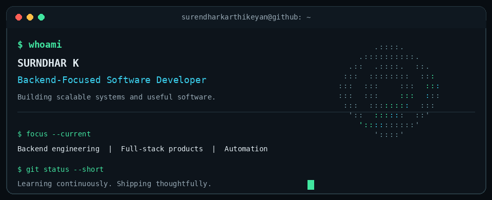

<!--
  GitHub Profile README
  Repository name must exactly match your GitHub username:
  surendharkarthikeyan
-->

<!-- Animated header -->

<!-- Typing introduction -->

  

---

## `whoami`

I'm **Surendhar K**, a Computer Science and Engineering student at **Bannari Amman Institute of Technology** (2022–2026), focused on backend engineering and full-stack product development.

I enjoy building software that solves practical problems — from secure AI workflows and recruitment platforms to automation systems.

- Backend-focused, with an interest in system design and scalable APIs.
- Comfortable building end-to-end applications, from database design to user interfaces.
- Interested in reliable systems, clean architecture, and practical automation.
- Currently strengthening my skills in backend engineering and software design.

 

---

## `tech stack`

**Backend**
 

**Frontend**
 

**Databases**
 

**DevOps & Tools**
 

---

## `featured projects`

| Project | What it does | Built with |
|---|---|---|
| **[Placement Drive Management](https://github.com/surendharkarthikeyan/placement_drive_management)** | Manages student eligibility, placement drives, recruitment stages, and selection workflows. | React · Node.js · MySQL |
| **Secure AI Chat** ([backend](https://github.com/surendharkarthikeyan/secure_ai_chat_backend) · [frontend](https://github.com/surendharkarthikeyan/secure_ai_chat_frontend) · [PII module](https://github.com/surendharkarthikeyan/secure_ai_chat_pii_reduction)) | AI chat workflow with PII redaction and OCR-based text extraction. | Spring Boot · Java · MySQL · React |
| **[AI Lead Inbox Triage Bot](https://github.com/surendharkarthikeyan/ai_lead_inbox_triage_bot)** | Classifies incoming emails, organizes leads, and prepares response drafts. | n8n · Gmail · Google Sheets · AI |
| **ProblemFindy** | Exploring a platform to discover and organize real-world problems from online communities. | Node.js · Express |

---

## `currently working on`

- Placement Drive Management System
- Academics ERP / COE module
- Improving Secure AI Chat
- Exploring system design and scalability

---

## `github activity`

---

### `build • learn • improve`

**Building solutions. Learning continuously. Engineering with purpose.**

